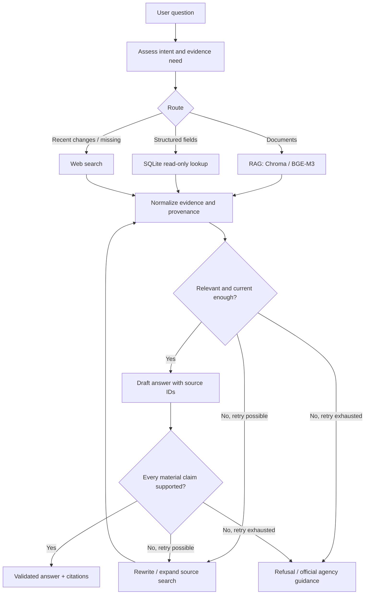

# AI5013 Project 5 — Public Services Assistant (Self-RAG)

**Implementation roadmap and environment specification**  
**Prepared:** 2026-10-10  
**Target duration:** 4 weeks / 20 working days  
**Project focus:** Vietnamese administrative-procedure assistant using LangGraph, local Ollama models, SQLite, Chroma, web search, and evidence-based refusal.

## 1. Goal and definition of done

Build an assistant that answers questions about administrative procedures (required documents, process, fees, receiving agency) using traceable official evidence. It must route queries across **RAG, structured database queries, and web search**, assess relevance and answer support, and **refuse or redirect** when evidence is inadequate.

Minimum rubric requirements:

- LangGraph orchestration with explicit nodes, edges, state and conditional routing.
- Three working tools: **web search, database, RAG**.
- Advanced RAG: **Self-RAG-inspired reflection** (`retrieve?`, `relevant?`, `supported?`) with source citations and controlled refusal.
- Fully local **LLM and embedding inference** using Ollama (no external LLM API).
- RAGAS evaluation: faithfulness, context precision/recall (plus answer relevancy where feasible).
- LangFuse tracing, demonstration and technical report.

**Important terminology:** The course's reference implementation uses an LLM-based reflection prompt returning structured relevance/support judgments. Describe it as a *Self-RAG-inspired reflection workflow* unless you actually implement the original Self-RAG method with specialized trained reflection tokens.

**Networking distinction:** Model inference stays on-premise; the required live web search necessarily makes external network requests. Avoid sending user questions to cloud-hosted LLMs, including during evaluation.

## 2. Scope and data

**Recommended first domain:** Civil registration (*hộ tịch*) rather than every administrative service. Start with birth registration, marriage registration, death registration, and closely related procedures. Treat this as an initial implementation choice, not a mandated domain.

**Suggested corpus:** 50–200 official procedure records, with an initial pilot of 20–30. The primary candidate is the National Public Service Portal (`dichvucong.gov.vn`). Confirm access rules, source reliability, document publication/effective dates, and availability of extractable fields before scaling. Do not assume a scraped record is still valid.

For each record, preserve:

- `procedure_id`, `title`, `field`, `jurisdiction`, `receiving_agency`
- `required_documents`, `procedure_steps`, `fees`, `processing_time`
- `source_url`, `source_title`, `retrieved_at`, `effective_date` (if available)
- `raw_text`, `document_version`/content hash, and provenance per field

Keep source text in RAG and extract structured fields to SQLite; do not treat the vector corpus and database as two independent authorities if they originate from the same record.

## 3. Actual hardware and current Ollama environment

These are **user-provided measurements as of 2026-10-10**, not independently re-benchmarked here.

| Component | Measured configuration |
|---|---|
| OS | Ubuntu 22.04.5 LTS, kernel 5.15.0-194-generic, x86_64 |
| CPU | Intel Xeon W-3235, 12 cores / 24 threads; AVX2/AVX-512 |
| RAM | 62 GB; ~59 GB available; 37 GB swap |
| GPU | 2 × NVIDIA RTX A5000, **24 GB VRAM each** (48 GB aggregate, not one shared 48 GB pool) |
| Driver | NVIDIA 575.57.08; CUDA toolkit / `nvcc` not required for Ollama |
| Root `/` | 98 GB total, 50 GB free |
| `/home` | 1.4 TB total, **61 GB free (96% used)** |
| Tooling | Docker, `uv` 0.11.26, Miniconda/Anaconda; system Python 3.10.12 |
| Connectivity | Internet accessible |

Ollama:

| Setting | Current value |
|---|---|
| Version | 0.30.8 |
| Service | `ollama` systemd service, `ollama` user |
| API bind address | `0.0.0.0:11434` (clients on same host should use `http://127.0.0.1:11434`) |
| Models directory | `/home/ollama/models` via `OLLAMA_MODELS` |
| `OLLAMA_NUM_PARALLEL` | `6` |
| `OLLAMA_MAX_LOADED_MODELS` | `4` |

### Installed models and assignment

| Model | Current disk footprint | Job | Notes |
|---|---:|---|---|
| `qwen3.5:latest` (9.7B, Q4_K_M) | 6.6 GB | Generator, routing and Self-RAG reflection | Use instead of course's `qwen2.5:7b`; document the substitution |
| `qwen3.6:latest` (36B MoE, Q4_K_M) | 23 GB | Local RAGAS judge / optional comparison | Higher loading footprint; evaluate independently from generator |
| `gpt-oss:latest` (20.9B, MXFP4) | 13 GB | Optional comparison, **not required** | Already present; avoid unnecessary extra model loading |
| `bge-m3:latest` (567M, F16) | 1.2 GB | 1024-dimensional multilingual embeddings | Use for Chroma |

Measured cold-start benchmarks (short Vietnamese prompt, `temperature=0`, `num_predict=200`, thinking disabled, full GPU offload):

| Model | Cold load | Prompt processing | Generation |
|---|---:|---:|---:|
| `qwen3.5` | 14.3 s | 296 tokens/s | ~80 tokens/s |
| `gpt-oss` | 21.4 s | 225 tokens/s | ~109 tokens/s |
| `qwen3.6` | 34.9 s | 143 tokens/s | ~100 tokens/s |
| `bge-m3` | — | 32 texts embedded in 3.2 s including load | — |

**Operational cautions:**

1. Explicitly set `num_ctx=8192` or `16384` for generation/evaluation; never rely on the Qwen model's 262K advertised maximum as the runtime context setting. Context and batching can dramatically raise KV-cache VRAM use.
2. `keep_alive=-1` can reduce model reloads during development, but *increases residency pressure*. Begin with one generator plus embeddings; load `qwen3.6` for evaluation separately. Do not assume both large models will remain on distinct GPUs without checking `ollama ps` and `nvidia-smi`.
3. Ollama's configured parallelism is `6`: concurrency multiplies memory needs. If out-of-memory occurs, **lower parallelism and/or context size** before changing models.
4. `/home` has only 61 GB free. Avoid pulling more models until storage is assessed; locate project outputs and Chroma indexes on a filesystem with sufficient headroom. `/home/student02` capacity/free-space must be checked with `df -h /home/student02` before assuming it is a separate volume.
5. `0.0.0.0` is a bind address, **not the client URL to use**. Confirm port 11434 is appropriately firewalled and not exposed publicly.

## 4. System architecture



**Safety design change relative to the teacher's code skeleton:** Do **not** route exhausted or unsupported cases into unconditional answer generation. Add an explicit refusal branch, bound retry count, source URL validation, and claim-to-evidence checks. An LLM's `supported: fully` judgment is not proof; assess it on adversarial/unsupported examples.

Suggested state fields: `query`, `intent`, `route`, `documents`, `db_results`, `web_results`, `evidence`, `draft`, `grades`, `citations`, `iteration`, `generation`, `refusal_reason`, `trace_id`.

## 5. Four-week, 20-day step-by-step plan

### Week 1 — Environment and dataset foundation

**Day 1 — Validate existing local inference, create reproducible Python environment**

- [ ] Capture baseline: `uname -a`, `nvidia-smi`, `df -h / /home /home/student02`, `ollama --version`, `ollama list`, `ollama ps`.
- [ ] Confirm service and endpoint: `systemctl status ollama --no-pager`, `curl -s http://127.0.0.1:11434/api/tags`.
- [ ] Confirm installed generator (`qwen3.5`) and embedder (`bge-m3`) are available; **do not pull `qwen2.5`** unless instructor requires exact matching.
- [ ] Initialize Git repository and new `uv` Python 3.11 environment; do not reuse system Python/torch 1.13.
- [ ] Install minimal dependencies: `langchain-ollama`, `python-dotenv`, `pytest`.
- [ ] Write `src/llm.py` and `scripts/verify_local.py`; verify nonempty Vietnamese output and BGE-M3's 1024-dimensional vector.
- [ ] Inspect `ollama ps` and `nvidia-smi` during inference to confirm GPU use; record load time and model/version metadata.
- [ ] Commit environment files, `.gitignore`, and verified Day 1 notes.

**Day 1 commands** (Ubuntu shell, executed as your normal project user):

```bash
# Observe: do not reinstall Ollama or pull models unnecessarily.
nvidia-smi
ollama --version
ollama list
curl -s http://127.0.0.1:11434/api/tags
systemctl status ollama --no-pager
df -h / /home /home/student02

# Create repository under a location with confirmed free space.
mkdir -p public-services-agent && cd public-services-agent
git init
uv python install 3.11
uv venv --python 3.11 .venv
source .venv/bin/activate
uv pip install langchain-ollama python-dotenv pytest
mkdir -p src scripts tests data/raw data/processed
 touch src/__init__.py
```

`src/llm.py`:

```python
from langchain_ollama import ChatOllama, OllamaEmbeddings

OLLAMA_URL = "http://127.0.0.1:11434"

llm = ChatOllama(
    model="qwen3.5",
    base_url=OLLAMA_URL,
    temperature=0,
    num_ctx=16384,
    keep_alive=-1,
)

# Instantiate the larger evaluator only when needed, not during normal inference.
def make_judge():
    return ChatOllama(
        model="qwen3.6",
        base_url=OLLAMA_URL,
        temperature=0,
        num_ctx=16384,
        keep_alive=-1,
    )

embeddings = OllamaEmbeddings(model="bge-m3", base_url=OLLAMA_URL)
```

`scripts/verify_local.py`:

```python
from src.llm import llm, embeddings

reply = llm.invoke("Giải thích RAG bằng đúng hai câu tiếng Việt.")
assert isinstance(reply.content, str) and reply.content.strip()
print("LLM response:", reply.content)

vec = embeddings.embed_query("Thủ tục đăng ký khai sinh tại Việt Nam")
assert len(vec) == 1024, f"Unexpected embedding dimension: {len(vec)}"
print("BGE-M3 embedding length:", len(vec))
print("Local inference checks passed.")
```

Run from the project root:

```bash
python -m scripts.verify_local
ollama ps
nvidia-smi
uv pip freeze > requirements-day1.txt
```

**Day 1 exit criteria:** Local text and embeddings succeed through Python; GPU use is confirmed; no external LLM API is invoked; environment is reproducible. If the `scripts` module invocation fails due to package setup, add `scripts/__init__.py` and retry.

**Day 2 — Decide exact administrative-procedure coverage**

- [ ] Select 2–4 civil-registration subdomains and list 20–30 target procedures.
- [ ] Define source acceptance rules: official URLs, accessible content, timestamps, jurisdiction and changes.
- [ ] Define canonical schema and source-level provenance strategy.
- [ ] Write a small manual gold set (5–10 questions) to test downstream retrieval.

**Day 3 — Collect and clean the initial corpus**

- [ ] Create a rate-limited ingestion script or manual export workflow compatible with source access rules.
- [ ] Normalize Vietnamese text and separate headers, documents, fees, processing time, agencies.
- [ ] Persist raw source, cleaned text, source URL, scrape/retrieval date and record hash.
- [ ] Validate 10 random records by comparing extracted fields against the original pages.

**Day 4 — Create and populate SQLite**

- [ ] Create tables and foreign keys for procedures and required documents.
- [ ] Import clean structured fields; keep source IDs and validity metadata.
- [ ] Implement parameterized, read-only data lookups (prefer safe query templates initially over unrestricted Text-to-SQL).
- [ ] Check missing values and jurisdiction differences.

Initial course-provided schema:

```sql
CREATE TABLE thu_tuc (
    id TEXT PRIMARY KEY,
    ten TEXT,
    linh_vuc TEXT,
    le_phi TEXT,
    co_quan TEXT,
    thoi_gian_xu_ly TEXT
);
CREATE TABLE ho_so (
    thu_tuc_id TEXT,
    thanh_phan TEXT,
    so_luong INTEGER,
    bat_buoc INTEGER
);
CREATE INDEX idx_hoso_tt ON ho_so(thu_tuc_id);
```

Add source/version/jurisdiction tables or fields as needed without losing compatibility with the sample schema.

**Day 5 — Implement baseline RAG retrieval**

- [ ] Add Chroma and chunk documents (begin with 700-character chunks, overlap 100 as in guidance; evaluate later).
- [ ] Ingest using BGE-M3; ensure each chunk has procedure ID and source URL.
- [ ] Implement top-5 retrieval and show source titles/snippets in a CLI test.
- [ ] Manually inspect top-k relevance on 10 representative questions.

**Week 1 deliverable:** Working local inference, traceable pilot corpus, populated SQLite and searchable Chroma collection.

### Week 2 — Tools and LangGraph baseline

**Day 6 — Three independent tools**

- [ ] Test `retrieve_docs(query)` for Chroma.
- [ ] Test safe SQLite queries for fees, requirements and agencies.
- [ ] Test DuckDuckGo or a self-hosted SearxNG search adapter; capture URLs and timestamps where available.

**Day 7 — LangGraph state and intent classifier**

- [ ] Define `AgentState` typed schema and route values (`knowledge`, `data`, `updates`, `mixed`).
- [ ] Write a deterministic fallback for routing failures.
- [ ] Unit-test questions that obviously require DB, corpus and web search.

**Day 8 — Implement baseline nodes**

- [ ] Router, retriever, DB, web, evidence normalization, draft generator, finalizer.
- [ ] Ensure responses carry their source IDs; maintain explicit error states.

**Day 9 — Conditional edges and fallback**

- [ ] Conditional routing, limited retries, and no infinite loops.
- [ ] Handle network outages, zero retrieval results, no DB rows, malformed model output.

**Day 10 — End-to-end baseline**

- [ ] Run 10–15 questions through the full graph.
- [ ] Capture which tools were called and why.
- [ ] Save baseline outputs for comparison with Self-RAG.

**Week 2 deliverable:** Working multi-tool agent (before sophisticated evidence critique).

### Week 3 — Self-RAG-inspired reflection and safety

**Day 11 — Retrieval necessity and relevance checks**

- [ ] Implement `retrieve?` source-decision policy and per-evidence `relevant?` scoring.
- [ ] Use structured JSON parsing with schema validation, not unconstrained string matching.

**Day 12 — Draft and claim support checks**

- [ ] Draft using retrieved sources only.
- [ ] Decompose consequential claims (fees, documents, agencies, processing times).
- [ ] Check `supported?` for each material claim; require an explicit source ID.

**Day 13 — Safe retry / refusal policy**

- [ ] Retry with query rewrite or alternative tool once or twice when evidence is partial.
- [ ] If unsupported after retries, refuse that claim or the full answer and refer to the relevant agency where reliably identified.
- [ ] Explicit terminal `refuse` node; never force generation after retry exhaustion.

**Day 14 — Source quality and citation controls**

- [ ] Verify citations map to actually retrieved evidence.
- [ ] Prefer up-to-date official sources; recognize uncertain effective dates and conflicting jurisdictions.
- [ ] Prevent generic web snippets from silently overriding authoritative records.

**Day 15 — Safety test suite**

- [ ] Test missing procedures, outdated entries, conflicting fees, fabricated user assumptions and ambiguous locality.
- [ ] Record unsupported-answer and correct-refusal rates.

**Week 3 deliverable:** Traceable evidence-based answers and controlled refusal under missing/uncertain evidence.

### Week 4 — RAGAS, LangFuse, presentation

**Day 16 — Evaluation dataset**

- [ ] Build 60 labeled items: 25 in-corpus, 15 structured DB, 10 update/web, 10 out-of-corpus/unsafe.
- [ ] Annotate gold source documents and expected answer/refusal; separate evaluation from any prompts used for tuning.

**Day 17 — RAGAS integration**

- [ ] Run faithfulness, context precision and recall; optionally answer relevancy.
- [ ] Configure the local evaluation judge explicitly (`qwen3.6`) and use Ollama embeddings: **do not permit default external LLM calls**.
- [ ] Check current RAGAS API against installed version; the teacher's sample imports may require adaptation.

**Day 18 — Baseline comparison**

- [ ] Hold dataset, generator, embeddings and retriever constant between baseline RAG and reflective version.
- [ ] Compare quality, unsupported-answer rate, correct-refusal rate and latency.
- [ ] Include case studies showing false acceptance and unnecessary refusal.

**Day 19 — LangFuse tracing + optional UI**

- [ ] Use self-hosted LangFuse if on-premise-only tracing is required.
- [ ] Trace each node, tool use, retrieval result, critique verdict, retry and response time.
- [ ] Build a small Streamlit demo only after core tests and tracing are stable.

**Day 20 — Demo and report**

- [ ] Prepare a reproducible `README.md` with environment, model tags, indexing, test and run commands.
- [ ] Diagram graph/state and explain the Self-RAG-inspired mechanism and refusal strategy.
- [ ] Report test-set construction, results, errors, limitations and source freshness considerations.
- [ ] Demo three tool paths and one out-of-corpus safe refusal.

**Week 4 deliverable:** Evaluated and traceable demonstration plus technical report.

## 6. Recommended repository layout

```text
public-services-agent/
├── README.md
├── pyproject.toml
├── uv.lock
├── .gitignore
├── .env.example
├── src/
│   ├── __init__.py
│   ├── state.py
│   ├── llm.py
│   ├── ingest.py
│   ├── tools.py
│   ├── nodes.py
│   ├── graph.py
│   ├── self_rag.py
│   └── eval.py
├── scripts/
│   ├── verify_local.py
│   ├── collect_data.py
│   ├── build_database.py
│   └── build_index.py
├── data/
│   ├── raw/
│   ├── processed/
│   ├── app.db
│   └── test_set.json
├── tests/
│   ├── test_tools.py
│   ├── test_routing.py
│   ├── test_self_rag.py
│   └── test_safety.py
└── app.py
```

When converting to reproducible `uv` project management, use `uv init`, `uv add`, and commit `pyproject.toml` + `uv.lock`; a bare `uv pip freeze` snapshot is only a convenient Day 1 interim artifact.

## 7. Evaluation design

| Evaluation axis | What to report |
|---|---|
| Retrieval | Context precision, recall; source relevance at top-k |
| Answer grounding | RAGAS faithfulness and manual claim support checks |
| User usefulness | Answer relevancy, answer completeness on answerable cases |
| Safety | Unsupported-answer rate, correct refusal rate, over-refusal rate |
| Workflow | Tool routing accuracy, retry frequency, tool failure recovery |
| Operational | End-to-end latency, model load effects, GPU VRAM utilization |

Compare **baseline RAG** versus **RAG + reflection/refusal**, holding other components constant. For safety metrics, explicitly count both improper answers and unnecessary refusals rather than rewarding a model that refuses everything.

## 8. Immediate next actions

1. **Run Day 1 observation commands** on the actual Ubuntu machine; confirm the location where the project will live and available disk space.
2. **Create fresh `uv` environment** with Python 3.11 (no global package installations).
3. **Run `scripts/verify_local.py`** against `qwen3.5` and `bge-m3`.
4. **Capture `ollama ps` + `nvidia-smi`** while the script runs.
5. **Record actual results**, then proceed to Day 2 data-source planning.

### Risks to track from the first day

- **Disk pressure:** `/home` is ~96% used; Chroma corpus and tracing/logs will grow.
- **VRAM contention:** two 24 GB GPUs do not guarantee concurrent residency at large contexts.
- **Source freshness:** administrative procedures can depend on jurisdiction and effective dates.
- **Safety gates:** reflection scores are model outputs, not ground truth.
- **Rubric fidelity:** substituting `qwen3.5` for the course's suggested `qwen2.5:7b` should be recorded and, if necessary, confirmed with the instructor.

---

**Project source basis:** The two supplied project documents (requirements + `Guidance_Project_Agent.pdf`), the prior conversation's implementation roadmap, and the hardware/benchmark specification supplied on 2026-10-10. Additional implementation decisions are labeled as recommendations rather than course mandates.
