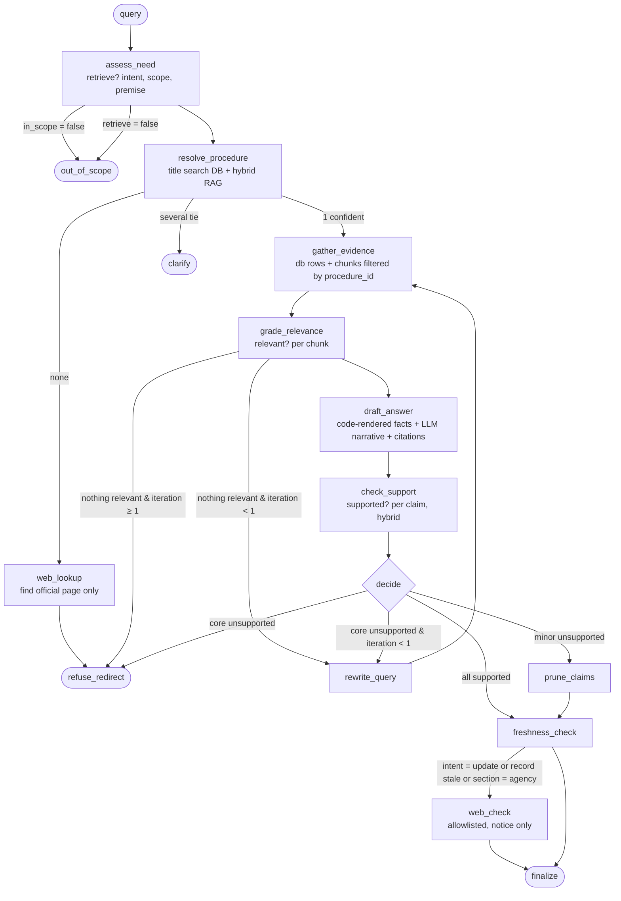

# Architecture — components, state, graph, and how the parts interact

> **Status note (2026-10-10).** This is the pre-implementation specification and is kept as written. The system as built, with every deviation and its reason, is `as-built-pipeline.md`; the one-page pipeline is `docs/08_handbook/PIPELINE.md`. Since Round 4 (corpus v2) the build also has: document tables and document chunks beside the procedure chunks (`docs/05_log/ROUND-4-DATA.md`), a change-notice freshness rule beside the web check, a discontinued-procedure status that ends in a refusal with reason `discontinued`, and a rule that claims naming an authority level or a deadline must be backed by a database row. Where this document and those differ, the as-built documents are current.

Companion to `PLAN.md` §5. This document is the one to read before writing `graph.py`.

---

## 1. Components and their single responsibility

```
┌─────────────┐   question    ┌────────────────────────────────────────────────┐
│   CLI /     │ ────────────▶ │                 LangGraph app                  │
│  test run   │ ◀──────────── │  state: AgentState (TypedDict)                 │
└─────────────┘   answer      │  nodes: pure functions state -> partial state  │
                              │  edges: conditional on state fields            │
                              └───────┬───────────┬───────────┬────────────────┘
                                      │           │           │
                              ┌───────▼──┐  ┌─────▼─────┐  ┌──▼─────────┐
                              │ SQLite   │  │ Chroma    │  │ Web search │
                              │ (facts)  │  │ (text)    │  │ (updates)  │
                              └──────────┘  └───────────┘  └────────────┘
                                      ▲           ▲
                              ┌───────┴───────────┴───────┐      ┌──────────────┐
                              │  ingest: one canonical    │      │   Ollama     │
                              │  record -> rows + chunks  │      │ qwen3.5/bge  │
                              └───────────────────────────┘      └──────────────┘
                                                              all nodes ──▶ LangFuse
```

| Component | Responsibility | Must not do |
|---|---|---|
| `ingest.py` | Turn one canonical procedure record into DB rows **and** corpus chunks, with the same `procedure_id` and `source_id` on both | Let DB and corpus drift apart (they come from the same record, so they must be rebuilt together) |
| `tools/db.py` | Read-only, parameterised lookups returning typed evidence records | Accept LLM-written SQL |
| `tools/rag.py` | Hybrid retrieval (BM25 + dense), optional `procedure_id` filter, returns evidence records | Return chunks without `source_id`/`section` metadata |
| `tools/web.py` | Allowlisted search, normalised to evidence records with tier = `web` | Be a source for structured facts |
| `self_rag.py` | The reflection prompts and parsers: `assess_need`, `grade_relevance`, `check_support` | Make routing decisions (those live in `graph.py` edge functions so they are visible) |
| `render.py` | Turn DB rows into the structured part of the answer (document list, fee line, agency line) by code | Call the LLM |
| `nodes.py` | Thin node functions that call tools / self_rag / render and write to state | Hide logic that should be an edge |
| `graph.py` | Nodes, edges, loop bound, compile | Business logic |
| `tracing.py` | LangFuse callback handler, span naming, metadata (verdicts, refusal reason) | — |
| `eval/` | Test set loader, RAGAS runner with local judge, safety metrics | — |

The key structural idea: **a single canonical record feeds both the DB and the vector store.** They are two views of one source, with different trust levels for different claim types, not two independent authorities.

---

## 2. The evidence record — the contract between tools and reflection

Every tool returns the same shape so that grading, citation and support checking never care which tool produced the evidence:

```python
class Evidence(TypedDict):
    evidence_id: str        # "db:required_documents:KS-01:3" | "doc:KS-01:required_documents:2" | "web:…"
    tier: Literal["db", "corpus", "web_official", "web_other"]
    procedure_id: str | None
    section: str | None     # required_documents | steps | submission_method | fees | agency | processing_time | conditions | legal_basis | summary
    text: str               # what the LLM sees
    structured: dict | None # for db tier: the row (fee value, document item, agency name, …)
    source_url: str | None
    retrieved_at: str | None
    effective_date: str | None
```

Tier ordering: `db` > `corpus` > `web_official` > `web_other`. Minimum tier per claim type is defined in `guardrails.md` §2 (L2).

---

## 3. State

Extends the professor's `AgentState` (keep their field names so the skeleton code still runs):

```python
class AgentState(TypedDict, total=False):
    # professor's fields
    query: str
    sub_queries: list[str]
    documents: list[dict]          # corpus evidence
    db_results: list[dict]         # db evidence
    web_results: list[dict]        # web evidence
    grades: dict
    route: str
    iteration: int
    generation: str
    # added
    need: dict          # {"retrieve": bool, "intent": "documents|fee|agency|time|steps|general|update",
                        #  "procedure_hint": str, "locality": str|None, "premise": str|None, "in_scope": bool}
    candidates: list[dict]         # [{procedure_id, title, score}] from resolve_procedure
    procedure_id: str | None
    evidence: list[Evidence]       # merged, graded, tiered
    draft: str
    claims: list[dict]             # [{text, type, evidence_ids, verdict: supported|unsupported|unknown}]
    outcome: str                   # answer | answer_partial | clarify | refuse | out_of_scope
    refusal: dict | None           # {"type": …, "agency": …, "portal_url": …, "missing": [...]}
    freshness: dict | None         # {"oldest_retrieved_at": …, "notice": bool}
    errors: list[str]
```

Rule: a node writes only the fields it owns; edge functions read state and return a label. This is what makes the LangFuse trace readable: each span shows exactly which fields changed.

---

## 4. The graph



Conditional edges (the rubric asks for these explicitly): `after_assess`, `after_resolve`, `after_grade`, `after_decide`, `after_freshness`. Five terminals: `finalize` (answer or answer_partial), `clarify`, `refuse_redirect`, `out_of_scope`. Loop: `rewrite_query` at most once (`iteration`).

### 4.1 Where the professor's skeleton is changed, and why

| Skeleton behaviour | Problem | Change |
|---|---|---|
| `decide_next` sends to `generate` when `iteration >= MAX_ITER` | Forces an answer exactly when evidence is worst | Exhausted retries go to `refuse_redirect` |
| `web_search → generate` directly | Web snippets become uncritiqued support | Web evidence enters `evidence` with tier `web_*`, goes through grading, and can never support structured claims |
| `query_db → generate` directly | DB path bypasses reflection | DB rows are evidence like any other; the whole answer passes `check_support` |
| `self_critique` reflects on the whole draft with one `supported` flag | One unsupported sentence sinks a correct list, or one supported sentence rescues an invented fee | Claim-level verdicts; partial path |
| `gate` refusal text is static | No redirection; the professor's own expected output says "chỉ dẫn cơ quan" | Refusal built from the `agencies` row + `source_url` of the nearest procedure |
| Retrieval over whole corpus by query | Chunks from sibling variants blend | `resolve_procedure` first, then retrieval filtered by `procedure_id` |

---

## 5. Node-by-node

**assess_need** — one LLM call with structured output. Produces `need`. Decides `retrieve?`: greetings, meta-questions, legal opinions ("tôi có được…?"), requests for personal data handling → `in_scope=false` or `retrieve=false`. Extracts `premise` if the user asserted a fact (so `check_support` can test it explicitly instead of the model agreeing by reflex).

**resolve_procedure** — no LLM. `search_titles(hint)` in DB (BM25 over `ten`) + dense search over title+summary chunks. Confidence rule (as implemented, 2026-10-10; replaces the earlier "top score ≥ τ and gap ≥ δ"): candidates come from fused BM25+dense ranks over summary and all chunks, with synonym expansion. **None**: an absolute floor on lexical *core-token coverage* of the question's hint words by the top candidate's title/summary (`core_floor` in `src/nodes.py:RESOLVE`); embedding cosine is not used for this decision because on this corpus it does not separate in- from out-of-corpus questions (measured ranges overlap; see R2 §5). **Clarify**: only when the runner-up within `sibling_gap` is a *sibling* (`variant_of` group) or a same-field neighbour; a pile of unrelated low scores is "none", not "clarify". **Sibling-invariant shortcut**: if the tied siblings share the identical structured value for the asked fact in the DB, answer for the group (never for document lists). Thresholds were hand-set on fixtures and the first test-set runs and are reported in R1 §5. None above floor → `web_lookup`. τ and δ are tuned on the test set in Phase 2 and reported.

**gather_evidence** — by `intent`: `documents` → `required_documents` rows + chunks with `section=required_documents`; `fee` → `fees` rows (with jurisdiction) + `fees` chunks; `agency` → `agencies` rows; `steps` → `steps` chunks; `general` → all. Always filtered by `procedure_id`. k=5 chunks.

**grade_relevance** — `relevant?` per chunk, structured `{relevant: bool, reason: str}`, batched in one prompt where possible. Parse failure → chunk treated as irrelevant (fail-closed). DB rows are not graded (they are exact matches on id).

**rewrite_query** — one LLM call to rephrase using the resolved procedure title; `iteration += 1`.

**draft_answer** — `render.py` produces the structured block from rows (numbered list of documents with `[db:…]` cites; fee line with jurisdiction and `[db:…]`; agency line). The LLM is asked to write the narrative parts *around* that block, citing `[doc:…]` ids, and is instructed that the structured block is fixed text. If `premise` exists, the draft must address it explicitly.

**check_support** — splits `draft` into claims (sentence/list-item level). For each claim: if it cites a `db:` id, verify programmatically (item text ⊂ row text; number equality; agency string equality). If it cites a `doc:` id, one LLM judgment `{supported: fully|partial|no}` against that chunk only. Uncited claim that contains a number, a document noun phrase, or an agency name → `unsupported` by rule. Claim types: `core` (anything the user asked for) vs `minor` (context sentences).

**decide** (edge) — all supported → `freshness_check`; only minor unsupported → `prune_claims` (removes them and appends "Không tìm thấy căn cứ về: …"); core unsupported → rewrite once, else `refuse_redirect`.

**freshness_check / web_check** — if intent is `update`, or oldest `retrieved_at` > N days, or answer touches the agency, run allowlisted web search for "<title> thay đổi / sửa đổi <year>"; if hits exist, append a notice with links. Never merges web text into facts.

**refuse_redirect** — builds the response from state, not from the LLM: refusal type, what was asked, what evidence exists (if a procedure was resolved: its title, its `agencies` row, `source_url`), what is missing, and the portal link. Templates in `guardrails.md` §4.

**finalize** — assembles answer + citations list + freshness notice; writes `outcome`.

---

## 6. Request walkthroughs (use these as the Phase 1 exit test and the demo)

1. **"Hồ sơ đăng ký khai sinh gồm những gì?"** → assess: intent=documents, hint="đăng ký khai sinh" → resolve: candidates KS-01 (thông thường), KS-02 (yếu tố nước ngoài), KS-03 (đăng ký lại) — scores close → **clarify**: "Bạn muốn hỏi thủ tục nào: (1) … (2) … (3) …". With "trong nước, lần đầu" → KS-01 → rows rendered → all `db:` claims verified → **answer** with citations and `retrieved_at`.
2. **"Lệ phí cấp lại CCCD là bao nhiêu?"** → resolve CCCD-02 → `fees` row has value + jurisdiction "toàn quốc" → **answer**. If the row says fee varies by province and `need.locality` is empty → **answer_partial**: states that it varies, cites the legal basis, asks for the province.
3. **"Thủ tục nhập tịch cho người nước ngoài?"** → resolve: nothing above floor → `web_lookup` restricted to `dichvucong.gov.vn` → **refuse_redirect**: "Kho thủ tục hiện không có thủ tục này. Thủ tục nhập quốc tịch do Bộ Tư pháp / Sở Tư pháp tiếp nhận; trang chính thức: <link if found>." No document list is produced.
4. **"Lệ phí khai sinh là 50.000đ phải không?"** → `premise="lệ phí = 50.000đ"` → resolve: khai sinh siblings tie, but the asked fact (fee) is identical across them → *sibling-invariant shortcut* (answer for the group instead of clarify; document lists never qualify) → row says miễn lệ phí (đúng hạn) → draft must address the premise → `check_support` verifies the number against the row → **answer**: "Không. Theo [db:…], đăng ký khai sinh (các biến thể …) đúng hạn được miễn lệ phí…". If the real DB shows differing fees among siblings, this case clarifies instead, which is correct.
5. **"Con tôi sinh ở Hàn Quốc, mẹ Việt bố Hàn, đăng ký ở đâu?"** → assess: in scope, intent=agency, hint="khai sinh có yếu tố nước ngoài" → KS-02 → `agencies` row → **answer** limited to the agency and the document list, plus a freshness notice (agency field) and a sentence that eligibility itself must be confirmed by the agency.
6. **Tool failure** (Ollama timeout, Chroma empty) → `errors` set → **refuse_redirect** with type `system_error`. Never `finalize`.

---

## 7. Tracing layout in LangFuse

One trace per question, named by test-set id. Spans per node. Each span's metadata records the decision that the next edge will read (`need`, `candidates[:3]`, per-chunk `relevant`, per-claim verdicts, `outcome`, `refusal.type`). Tag traces with `variant=baseline|guardrailed|ablation_x` so the comparison in `evaluation.md` can be done from LangFuse exports as well as from local JSON.
