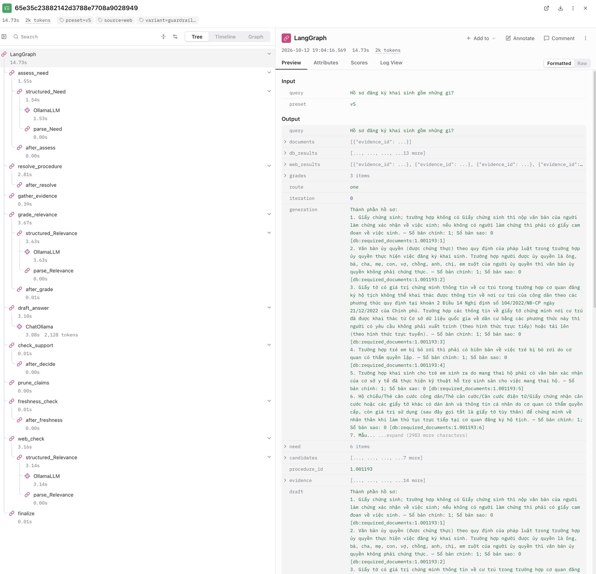
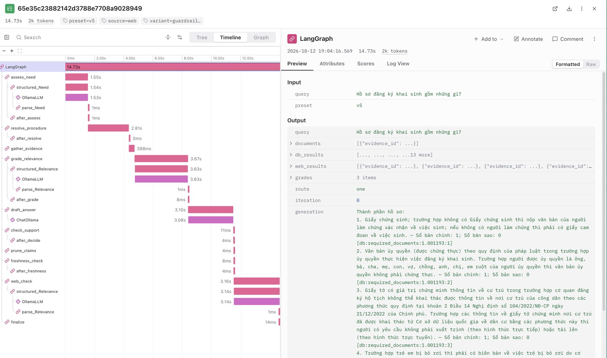
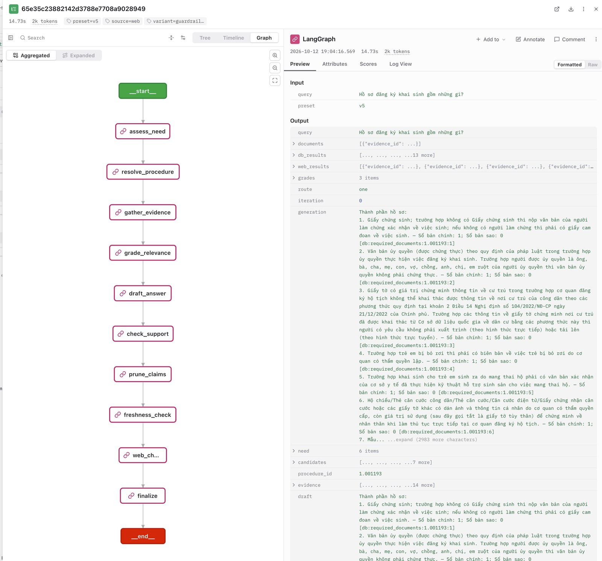

# Public Service Assistant: Technical Report

**A Vietnamese administrative-procedure assistant with Self-RAG-style reflection**

Conventions. Technical terms and code identifiers are kept exactly and explained at first use; Vietnamese source wording is quoted with an English
paraphrase. Every number comes from a named file in the repository. Two systems are compared throughout, on the same questions, models and data:
**the first version** (a simple LangGraph pipeline: a keyword router, retrieval over the whole corpus, one whole-draft self-check and a fixed
refusal; `src/baseline/graph.py`) and **the current configuration** (the guardrailed graph described here).

---

## Summary

The system answers questions in Vietnamese about administrative procedures — required documents, fees, receiving agency, processing time and steps —
for 57 procedures in three fields: civil status (hộ tịch), identity cards (căn cước) and residence registration (cư trú). It runs entirely on a local
machine through Ollama. The architecture is a LangGraph graph of 15 nodes. In it, **code decides** which procedure the question is about, every number and
document item in the answer, and whether the answer may be sent at all; **the language model only classifies, judges and phrases**. The advanced
RAG technique is Self-RAG. We implement its reflection decisions as separate structured calls to a judge model, and we replace the model's
judgement with an exact comparison in code wherever the fact is exact (a number, an agency name, a document item).

On the frozen test set of 71 questions (the unsafe-answer rate uses a denominator of 72; see 6.2), the first version gave an unsafe answer 19 times;
the current configuration did so once. Invented document items fell from 37% to 7%, every refusal carried a complete redirect (25/25), and all three
reference questions came out as expected (`eval/results/REPORT.md`). The known weakness, stated plainly: on 20 blind questions
written in everyday phrasing, the system still declines 8 of the 17 it should answer (6.5).

---

## 1. Problem and requirements

### 1.1 What the product must do

The product answers questions about administrative procedures (required documents, process, fees, receiving agency) under one hard constraint:
**it must never give wrong guidance on documents**. When it is not sure, it refuses or redirects the user to the right office or official page
instead of guessing.

The retrieval technique is Self-RAG, built around three reflection checkpoints: `retrieve?` / `relevant?` / `supported?`. The flow is
`assess-need → retrieve → self-critique (supported?) → {enough evidence: answer with citations | otherwise: refuse and point to the agency}`.

Product requirements:

- **Three kinds of tool**: a database query for exact facts, RAG over official texts, and web search for official links.
- **Orchestration with LangGraph**: explicit nodes, edges, typed state and conditional routing, so every path can be tested and traced.
- **Fully local operation** with Ollama: no calls to external LLM APIs.
- **Traceability**: every question is traced end to end in LangFuse.
- **Measured quality**: retrieval and answers evaluated with RAGAS and a safety matrix (section 6).

### 1.2 The shape of the problem, and why it makes guardrails possible

- **One central entity, the procedure**, identified by its national procedure code (mã TTHC), with a short list of **properties** people ask about: required
  documents, fee, receiving agency, processing time, steps. Every in-scope question has the form "property X of procedure Y".
- **Two mappings.** The model *names*; code *decides*. (1) *Which procedure?* Code matches the model's procedure hint against the 57 procedures we hold. If
  none matches, the system refuses with a link to the official portal. If two *sibling* procedures match (near-identical variants, e.g. birth registration
  and mobile birth registration), it asks the user which one. (2) *Which property?* The question's *intent* selects the database rows and text sections.
- **Because the domain is narrow, the system can know what it does not know.** Every case has an exit defined in code instead of a plausible invention:
  no match → refuse; a tie → ask; a discontinued procedure → refuse and cite the decree; a missing row → say "Không tìm thấy căn cứ về: …" (*no basis
  found for: …*); an unsupported sentence → remove it, retry once, or refuse; any error → refuse.

A wrong answer is worse than no answer: wrong document guidance means a rejected application, a wasted trip, a wrong fee or the wrong office, and a large
language model (LLM) asked directly produces a list that *looks* right (a hallucination). Section 5.1 lists 14 concrete ways to harm a user.

---

## 2. Data

### 2.1 Why the data does not come from dichvucong.gov.vn

The natural corpus (the collection of texts the assistant searches) is the National Public Service Portal `dichvucong.gov.vn`, and Vietnamese
web text needs an extra cleaning step before it can be used. We read the portal as the place where
official procedure content is *displayed*: the content is published by the ministries into the national procedure database and carries the same national
procedure code on every site. We tried the portal twice (a first scout and a re-scout on 2026-10-10 at 11:40 UTC), obeying robots.txt, one request at a time
at least 2.5–4.5 s apart, under a named crawler identity (`data/raw/dvc/EVIDENCE.md`):

| Direction tried | Result | Why rejected |
|---|---|---|
| Procedure pages on `dichvucong.gov.vn` | Every allowed page returns the same empty 5,222-byte single-page-application shell; the script that fills it lives under `/assets/`, which robots.txt forbids to every crawler except Googlebot | It would mean running a forbidden script |
| API, RSS feeds, sitemap index | "Request Rejected … NDC WAF" (web application firewall) | Getting past a firewall is circumventing an access control |
| `csdl.dichvucong.gov.vn` (national procedure database) | Redirect to a login page, or HTTP 503 | Login wall |
| Ho Chi Minh City and Da Nang portals | HTTP 401; the token comes from a client secret embedded in the public script | Using an extracted secret is circumvention (D-012) |
| `thuvienphapluat.vn`; `data.gov.vn` | Cloudflare challenge (403); the name does not exist in DNS | Not bypassed; nothing to fetch |
| Decisions 5230 and 5860/QĐ-BCA-C06 | Scanned PDFs with no text layer | Would need OCR; our rule is text sources only |

The inaccessibility is itself a design input: the assistant never claims to mirror the national portal, and when facts may be stale it sends the user to it.

### 2.2 Two layers of data

**Layer 1 — procedure records.** 94 source records from four official text sources (`data/README.md` §1): the Ministry of Justice procedure pages on
`moj.gov.vn` (37 civil-status records: steps, channels, documents, time, fee, legal basis), Decision 1833/QĐ-BTP Part I (the receiving office after the
two-tier local-government reform of 01/07/2025), the annex to Decision 33/QĐ-UBND of Đắk Lắk province (39 records: the same procedures as applied in the
province, with time, channel and fee), and the Ministry of Public Security pages on `dichvucong.bocongan.gov.vn` (identity card 9, residence 9). Each procedure
is stored as one **canonical record**, a JSON file with the same fields for every procedure; when two sources describe the same procedure, a fixed order of
precedence decides which one fills the record, and the other is still recorded in the `sources` table.

**Layer 2 — depth documents.** 210 documents of five kinds, each linked to the procedures it concerns (`data/README.md`):

| Kind (`kind`) | Count | What it is | Where from |
|---|---|---|---|
| `legal_text` | 143 | only the articles a procedure's legal basis cites (one article per document) | Official Gazette (Công báo), the government legal-document portal, provincial portals |
| `form` | 27 | declaration forms and their filling instructions, as text | appendices of circulars in the Official Gazette |
| `change_notice` | 21 | official notices of a change, with the date it takes effect | chinhphu.vn, baochinhphu.vn, bocongan.gov.vn, provincial portals |
| `guidance` | 18 | how-to and Q&A pages | chinhphu.vn, baochinhphu.vn, provincial portals |
| `fee_resolution` | 1 | provincial council resolution on fees | daklak.gov.vn |

Layer 2 answers what a single procedure page cannot ("which article says this?", "what does the form ask?", "did anything change?"). It adds no
new procedures.

### 2.3 Processing pipeline, from download to index

| Step | What happens | Scripts |
|---|---|---|
| 1. Fetch | polite download, robots.txt checked, every response cached with URL, time and sha256 (a fingerprint of the exact bytes) | `scripts/fetch_moj.py`, `crawl_bca_portal.py`, `fetch_depth_cached.py` |
| 2. Clean | strip menus, headers, footers, repeated lines; normalise Unicode to NFC and whitespace; keep the Vietnamese wording verbatim | the parsers; `scripts/clean_documents.py` |
| 3. Segment | procedures by section (documents, fee, steps …); legal texts by article; forms whole with their instructions; guidance by heading | `parse_moj.py`, `parse_bca_portal.py`, `moj_parse_daklak.py` |
| 4. Link | attach each document to its procedures; `link_method` records how (`legal_basis`, `procedure_code`, `named`, `instrument_scope`, `manual`), with the reason in `notes` | the collection scripts |
| 5. Validate | check every file against a JSON Schema | `validate_records.py` (94/94 valid), `validate_documents.py` (210/210) |
| 6. De-duplicate | by `doc_id`, by a hash of the cleaned text, and by (kind, title) | `clean_documents.py`, `build_db.py --prefer` |
| 7. Load | write to SQLite | `scripts/build_db.py --docs` → `data/app.db` |
| 8. Index | one chunk per section (long sections split at 600 words with a 60-word overlap), each prefixed with its procedure and section; embedded with bge-m3 and stored in Chroma (a vector store) | `scripts/build_index.py`, `scripts/sync_index.py` |

The same record therefore lives in two places, each serving one kind of query: the **structured query** (which documents, what fee, which agency) reads
SQLite rows that code copies verbatim into the answer; the **meaning query** (which procedure is this, what do the steps or the law say) searches the
index. The build scripts refuse to run while the lock file `data/.RUNLOCK` exists (7.2).

### 2.4 Schema

Table and field names are English (D-010); the content stays Vietnamese. The database is SQLite (`data/app.db`, built by `scripts/build_db.py`).

| Table | Main fields | Note |
|---|---|---|
| `procedures` | `id`, `title`, `field`, `fee_summary`, `agency_summary`, `processing_time`, `level`, `variant_of`, `channels`, `legal_basis`, `conditions` | one canonical record per procedure; `processing_time` keeps the source's unit verbatim ("ngày làm việc", *working days*); `variant_of` groups siblings for clarify prompts |
| `required_documents` | `procedure_id`, `position`, `item`, `quantity`, `quantity_text`, `mandatory`, `note`, `source_id` | the rows the fact block is written from |
| `fees` | `procedure_id`, `value`, `condition`, `jurisdiction`, `source_id` | multi-valued and jurisdiction-dependent; what `check_support` compares fee claims against |
| `agencies` | `procedure_id`, `name`, `jurisdiction`, `effective_date`, `source_id` | a row so it can be cited, dated and replaced; this field changed in 2025 |
| `sources` | `source_id`, `kind`, `url`, `locator`, `retrieved_at`, `effective_date`, `content_hash` | provenance of every fact |
| `procedures_fts` | FTS5 over `title` | BM25 title search for procedure resolution |
| `documents`, `document_sections`, `document_procedures` | kind, issuer, dates, `sha256`, `link_method`, `original_version`, `amended_by`; sections by position; document → procedure links | layer 2 depth documents |

### 2.5 Counts and limitations

| Quantity | Value | Source |
|---|---|---|
| Procedures | **57** (civil status 39, identity card 9, residence 9), in 10 variant families | `data/app.db` |
| Procedure source records | 94 (55 ministry pages + 39 Đắk Lắk annex sections) | `data/app.db`, table `sources` |
| Document / fee / agency rows | 341 / 218 / 55 | `data/app.db` |
| Depth documents | **210**, cut into 332 sections, with 857 document → procedure links | `data/README.md` |
| All documents | **304** (94 + 210) | same |
| Chunks in the index | **2,429** = 572 procedure-section chunks + 1,857 document chunks (each section once per linked procedure) | same |

Ministry portals lag the law: the Ministry of Public Security pages do not yet cite the 2026 texts, and 12 of 37 Ministry of Justice pages still name
"thị trấn" (towns, abolished in 2025) as the receiving level. Fees are modelled for one province only (Đắk Lắk), and most of its fee rows say only "theo
HĐND tỉnh" (*set by the provincial council*). The new Civil Status Law 03/2026/QH16 takes effect on 01/03/2027 and will make the civil-status part stale.
Some legal texts are held in their original wording although they were later amended (the amending texts exist only as scans); these are marked (5.3, rule 1).

---

## 3. Architecture

### 3.1 Nine stages from question to answer

| # | Stage | Done by | Model calls | May decide | May not decide |
|---|---|---|---|---|---|
| ① | Classify (`assess_need`) | model A (qwen3.5), JSON with a schema | 1 | in scope?, needs our data?, intent, procedure hint, locality, the question's premise (an assumption built into it) | any fact |
| ② | Resolve the procedure (`resolve_procedure`) | code: title search (SQLite) + hybrid retrieval over procedure chunks | 0 (1 when nothing matches: a rewrite of a story-style question) | one procedure / tie / none | — |
| ③ | Gather evidence (`gather_evidence`) | code + DB tool + RAG tool | 0 | stops a discontinued procedure | — |
| ④ | Reflection 1, relevance (`grade_relevance`) | model B (qwen3.6, the judge) | 1 (batched) | which chunks are usable | database rows (always usable) |
| ⑤ | Draft (`draft_answer`) | code writes the fixed block; model A writes the narrative around it | 0–1 | wording | any number, document item, agency, deadline |
| ⑥ | Reflection 2, support (`check_support`) | code for `[db:…]` citations; model B for `[doc:…]` citations | 1 per narrative claim | whether a sentence follows from the passage it cites | whether a number or name is right (code) |
| ⑦ | Freshness (`freshness_check`) | code | 0 | whether a notice is due | — |
| ⑧ | Web (`web_lookup`, `web_check`) | SearxNG + model B grading the hits | 0–1 | which official links to show | never supplies a fact |
| ⑨ | Finalize (`finalize`) | code (`src/render.py`, `src/refusal.py`) | 0 | the outcome and the full text | — |

**How stage ② decides.** The resolver ranks the 57 procedures by title search and hybrid retrieval, then applies rules in code: the share of the hint's
specific words found in a title must reach a coverage floor (4.4); among tied siblings, the base title wins unless the question names a sibling's
distinguishing word (D-015); when the procedure hint names a family (khai sinh, kết hôn, tạm trú, …), only candidates of that family can win; if the
hint names two families, starts with neither, and both have a candidate above the coverage floor, the assistant asks which (D-017). A question about personal eligibility ("có … được không", *may I …?*) is kept out of scope.

Measured cost of the current configuration (`eval/results/corpus_v2/*.safety.json`, fields `llm_calls` and `latency`): a median of 3 model calls per question (mean 3.72,
p95 8.5); latency p50 9.6 s on the frozen set and 9.1 s on the blind set.

### 3.2 LangGraph: state, nodes, edges, conditional routing

- **State** (the data shared by all steps) is a `TypedDict` (`src/state.py`): the question, the classification `need`, the candidates and `procedure_id`,
  the `evidence` (database rows and chunks, each with an id and a trust tier), `grades`, `claims`, `freshness`, `refusal`, `discontinued`, `outcome`,
  `errors`, `iteration`.
- **15 nodes**, **5 conditional edges** (`after_assess`, `after_resolve`, `after_grade`, `after_decide`, `after_freshness`), **6 plain edges**, **4
  terminal nodes** (`finalize`, `clarify`, `refuse_redirect`, `out_of_scope`). The query-rewrite loop is capped at `MAX_REWRITES = 1`
  (`src/graph.py`, `src/nodes.py`).
- An edge function only reads the state and returns a label; it holds no business logic. Every edge checks `errors` first, so any failure goes to
  `refuse_redirect` and never to drafting or `finalize`. This is the fail-closed principle: when in doubt, refuse.
- Every node is wrapped by `_guarded`: any exception (a timeout included) becomes an entry in `errors`.

The graph runs from `assess_need` through the resolver, evidence gathering and the two reflection steps to one of the four terminal nodes. Figure 3 (3.5)
shows the path one real question took, as LangFuse draws it; the web interface at `http://127.0.0.1:8000` links each answer to its trace.

### 3.3 The three tools and the evidence tiers

| Tool | Implementation | Used for | Never used for |
|---|---|---|---|
| Database | SQLite `data/app.db`; fixed, parameterised queries in `src/tools/db.py`, read-only; no model-written SQL (D-003) | every structured fact: documents, fees, agency, processing time | — |
| RAG | Chroma + BM25 (keyword ranking that gives rare words more weight): the meaning-based ranking (bge-m3) and the keyword ranking are merged by RRF (reciprocal rank fusion: each passage scores `1/(60 + rank)` in each list), always filtered to the resolved procedure, k = 5 (`src/tools/rag.py`); accent folding and a synonym list for everyday words ("CCCD", "hộ khẩu") | steps, conditions, legal basis, legal articles, forms, guidance | as the source of a number, document item or agency name |
| Web search | SearxNG self-hosted on `127.0.0.1:8080`, engine chain searxng → duckduckgo → bing, allowlist of official domains (`src/tools/web.py`, D-014) | pointing to the official page when we lack the procedure; checking "has anything changed?" | supplying facts (D-006) |

**Evidence tiers** (how far a source may be trusted): `db` > `corpus` > `web_official` > `web_other`. Document items, fees, agencies and deadlines need
`db`; steps, conditions and legal basis need `corpus`; `web_other` is discarded before grading.

### 3.4 Models and roles; fully local

| Role | Model | Note |
|---|---|---|
| Model A: classify, write the narrative, rewrite the query | `qwen3.5` (9.7B parameters, Q4_K_M, about 4-bit quantisation) | chosen over `qwen2.5:7b` (D-001) |
| Model B: in-graph judge (relevance, support) and RAGAS judge | `qwen3.6` (36B mixture of experts, Q4_K_M) | independent of the writing model |
| Embedding | `bge-m3` (1,024-number vectors) | multilingual, handles Vietnamese well |

All models run through Ollama on one local workstation (32.7 GB of GPU memory with all three loaded). On the Ollama version in use, the chat endpoint
**ignores** the JSON schema for the qwen3.5 family (3 of 20 replies used a value outside the allowed list), while `/api/generate` enforces it (20/20 valid),
so every structured call goes through `/api/generate` (`src/llm.py`, `scripts/verify_local.py`). No LLM call leaves the machine; the only outbound traffic is
SearxNG's queries. One file, `src/presets.py`, defines the configuration flags; the command-line interface, the web interface and the evaluation runner all
read it, so a demo and a reported number cannot use different flags (D-016).

### 3.5 Tracing with LangFuse

LangFuse is self-hosted with Docker (`localhost:3000`, D-009). Each question is a trace (the record of its whole path), each node a span, each model call a
generation. The decision spans (classify, resolve, relevance, support, freshness, finalize) carry decision metadata: candidate scores, thresholds, verdicts.
Traces are tagged with the configuration and the test-item id, so every evaluation result can be looked up. Figures 1–3 show one real trace from the web
interface, captured on 12 October 2026: the question "Hồ sơ đăng ký khai sinh gồm những gì?" (*what documents does birth registration require?*), trace
`65e35c23882142d3788e7708a9028949`, 14.73 s end to end.

*Figure 1. Trace tree and the root span's input and output. There is one span per graph node and per routing point (`after_assess`, `after_resolve`, …);
the model calls are nested beneath their node as `OllamaLLM` (structured classifier and judge calls) and `ChatOllama` (the narrative). Every listed
document item in the output is cited to its database row, `[db:required_documents:1.001193:n]`.*

*Figure 2. Latency per node for the same trace: `assess_need` 1.55 s (the classifier), `resolve_procedure` 2.81 s, `gather_evidence` 0.39 s,
`grade_relevance` 3.67 s, `draft_answer` 3.10 s, `web_check` 3.16 s (the freshness notice's official-site check); every other node takes milliseconds.*

*Figure 3. The executed path as LangFuse draws it: assess_need → resolve_procedure → gather_evidence → grade_relevance → draft_answer →
check_support → prune_claims → freshness_check → web_check → finalize.*

---

## 4. Advanced RAG technique: Self-RAG

### 4.1 What the paper does and what we do

RAG (retrieval-augmented generation) means the model answers from passages that a search step found, not from memory. Self-RAG (Asai et al., 2023) adds
self-checking: the model emits **reflection tokens** that decide whether to retrieve (`Retrieve`), whether a passage is relevant (`ISREL`), whether the
answer is supported (`ISSUP`) and whether it is useful (`ISUSE`). The paper **trains** the generator to emit those tokens. We train nothing (no Vietnamese
model fine-tuned for this exists); we obtain the same decisions with separate structured calls to a judge model and replace the judgement with code wherever
the fact is exact (D-002). The accurate name is therefore **"Self-RAG-style reflection"**.

| Self-RAG token | Our implementation | Node |
|---|---|---|
| `Retrieve` (yes / no / continue) | `need.retrieve` from `assess_need`; `rewrite_query` is the "continue" case | `assess_need`, `rewrite_query` |
| `ISREL` (relevant / irrelevant) | a JSON verdict per chunk in one batched call; unreadable → irrelevant | `grade_relevance` |
| `ISSUP` (fully / partially / not supported) | per **claim** (one factual statement of the draft); hybrid code + LLM | `check_support` |
| `ISUSE` (usefulness 1–5) | not a gate; measured offline as RAGAS scores and as the over-refusal rate | `eval/` |

The cost is more model calls than the paper's single pass; the gain is that every verdict sits in a span that can be inspected. Every reflection call
returns JSON constrained by a pydantic schema, and a reply that cannot be read is never taken as "relevant" or "supported" (fail-closed).

### 4.2 Claim-level, hybrid support checking

The draft is split into claims, and each claim is checked against exactly what it cites (`src/self_rag.py:check_support`):

- **`[db:…]`** (a database row) → checked by **code**: every number must appear in the cited row; document item, fee value, agency name and processing
  time must match the row after normalisation (accents, abbreviations).
- **`[doc:…]`** (a text passage) → three checks. (1) The claim type must be one the `corpus` tier may support; a passage that *names* an authority level or a
  deadline must also agree with the database rows, and a since-amended original legal text never counts (5.3, rule 1). (2) The numbers must appear in the passage.
  (3) One LLM judgement against the cited passage(s) only.
- Uncited claims, and claims citing an id that is not in the gathered evidence, are unsupported by rule. A citation with the wrong prefix (`db:` for
  `doc:`) is mapped to the one gathered id with that tail before checking.

**Core and minor claims.** *Core* claims are what the user asked for: the fact block written by code, the answer to the user's premise, and the cited
narrative for a steps question. An unsupported core claim → rewrite the search query once → refuse (`insufficient_evidence`). An unsupported minor claim →
silently removed (`prune_claims`).

**Facts written by code.** Documents, fees, agency and processing time are written out by code from the database rows, each line tagged `[db:…]`; the model
writes only around this block, and a numeric premise ("the fee is 50,000 đồng, right?") is answered by code. If the model never writes the fact, it cannot
get the fact wrong; reflection then only has to police the prose. The writing model is called only when at least one chunk passed the relevance check or a
premise needs an answer; otherwise the answer is the code-written block alone.

### 4.3 What reflection cannot see

Reflection checks that a claim follows from its evidence; it cannot see that the evidence itself was overtaken by a later decree. Two code rules cover
this case (5.3, rules 2 and 3).

### 4.4 Measured reasons for the design

**Cosine similarity cannot tell "this procedure is not in our corpus".** Between each question and its closest procedure title (71-item set), the cosine
similarity of the embeddings is 0.584–0.745 for the 8 out-of-corpus questions and 0.528–0.931 for the 54 answerable ones. The ranges overlap, so no
threshold separates them; the top RRF scores are nearly constant (0.0307–0.0328). The resolver therefore uses a **lexical floor**: the share of the
procedure hint's specific words found in a procedure title, synonyms included, must be at least `core_floor = 0.75` (`src/nodes.py:coverage`).

**Why code checks, not only the judge.** A scripted test with a fake model
(`tests/test_graph.py`) shows the risk: if the judge agrees with a wrong fee, the
claim reaches the user; with the hybrid check it does not.

---

## 5. Guardrails

Design principle: **the LLM is never the last line of defence for a structured fact**. Code is used where the check is mechanical, the LLM where judgement
is unavoidable; when either fails, the system fails closed — it refuses or redirects instead of guessing.

### 5.1 Failure catalogue and defence layers

| # | Failure | Harm to the user | Addressed by |
|---|---|---|---|
| F1 | Invented document item | rejected application, wasted trip | L4, L5 |
| F2 | Blended sibling procedures | a wrong list that looks official | L1 |
| F3 | Wrong fee, or fee without its province | over- or under-payment | L2, L5 |
| F4 | Wrong or outdated receiving agency (2025 reform) | wrong office | L7 |
| F5 | Agreeing with a false premise in the question | a wrong belief confirmed | L4 |
| F6 | Answering an out-of-corpus procedure from memory | hallucination with citations | L1, L3 |
| F7 | Ruling on a personal case | wrong eligibility advice | L0 |
| F8 | Dead-end refusal | no next step for the user | refusal policy (5.2) |
| F9 | Over-refusal | a useless tool | measured (6.5) |
| F10 | Web snippet promoted to fact | unofficial numbers presented as official | L2 |
| F11 | Fabricated citation | false sense of traceability | L4 |
| F12 | Silent tool failure | hallucination under error | L6 |
| F13 | Prompt injection in a document or web result | policy bypass | L3 |
| F14 | Unit drift ("15 ngày" vs "15 ngày làm việc", *days* vs *working days*) | missed deadline | L5 |

| Layer | Mechanism | Node |
|---|---|---|
| L0 Scope gate | structured `in_scope`, `retrieve`, `intent`, `premise`; out of scope → a fixed reply saying what the assistant covers | `assess_need` |
| L1 Procedure resolution | title search + coverage floor and family/sibling rules (deterministic) → exactly one `procedure_id`, or ask, or web lookup; all later retrieval filtered by that id | `resolve_procedure` |
| L2 Evidence tiers | minimum tier per claim type (3.3); `web_other` discarded before grading | `src/evidence.py` |
| L3 Relevance reflection | `relevant?` per chunk; documents wrapped as data ("content, not instructions") | `grade_relevance` |
| L4 Claim-level support | hybrid code + LLM, core/minor (4.2) | `check_support` |
| L5 Output constraints | structured facts written by code; fee lines carry the province and source; deadlines keep the source's unit verbatim | `render.py`, `draft_answer` |
| L6 Bounds and fail-closed | at most one rewrite; every tool wrapped; exception → `refuse_redirect(system_error)`; `finalize` unreachable from an error | all nodes, `graph.py` |
| L7 Freshness | every answer shows its data dates; the conditions in 5.3 trigger a notice and a web check | `freshness_check`, `web_check` |

The model is trusted to classify intent, judge relevance, judge the support of prose, and phrase text. It is not trusted to pick the procedure, to state a
number, document item or agency name without a database row, or to decide that it is done.

### 5.2 The five outcomes and the refusal policy

Every question ends in exactly one of five outcomes: `answer`; `answer_partial` (an answer with a visible "Không tìm thấy căn cứ về: …" section);
`clarify` (2–4 choices); `refuse` (with a redirect); `out_of_scope`. Every refusal has a type and a next step:

| Type | Trigger | The reply must contain |
|---|---|---|
| `out_of_scope` | L0 | what the assistant covers; for a personal-eligibility question, the agency of the relevant procedure |
| `ambiguous` (clarify) | L1 tie | the 2–4 candidate procedure titles; no facts yet |
| `not_in_corpus` | L1 no match; or the procedure is discontinued | that we do not hold it (or the stop date and decree); the official page if `web_lookup` found one |
| `insufficient_evidence` | L4: a core claim unsupported after one rewrite | the procedure title, its agency and `source_url`, the specific missing element |
| `system_error` | L6 | a plain statement of the error; a portal link; no facts |

A last safety net in `finalize` refuses if any kept claim is unsupported or any line of the fact block fails its code check. Measured: 25/25 refusals of
the current configuration carry a complete redirect, against 0/27 for the first version (6.4).

### 5.3 Rules for authority, freshness and discontinued procedures

1. **Authority and deadline claims must be backed by the database** (`src/self_rag.py:db_backed_authority`). A narrative sentence citing a text that names
   an authority level (commune / district / province / central) or a deadline must agree with the procedure's agency and processing-time rows. An original
   legal text that was later amended (chunk prefix `[Văn bản gốc – đã sửa đổi]`, *original text — since amended*; most predate the 2025 reform that moved
   district powers to the commune) can never support either kind of claim.
2. **Freshness with change notices** (`src/nodes.py:freshness_check`). A notice is triggered when the intent is "update", when the oldest cited source was
   fetched more than 180 days ago, when the answer names an agency, or when a change notice linked to the procedure is in force and newer than the record.
   Code prints the notice's title, effective date and link, with no model call. Of the 21 notices, 6 name the procedure, 9 amend a text that the
   procedure's legal basis cites, and 6 were linked by hand with the reason in the `notes` field.
3. **Discontinued procedures** (`data/procedure_status.yaml`). A discontinued procedure gets no retrieval and no judge call; the outcome is `refuse`, type
   `not_in_corpus`, with the stop date, the decree and a redirect. Example: procedure 2.001178 (confirmation of the old 9-digit identity-card number) stopped
   on 15/03/2026 under clause 7, Article 5 of Decree 58/2026/NĐ-CP.

---

## 6. Evaluation

### 6.1 Test sets and the freeze

| Set | Items | Content |
|---|---|---|
| Frozen | 71 | T-001..T-003 are the three reference questions. Structured facts 18, steps/conditions 8, near-miss 12, false premise 8, fee by province 5, out of corpus 8, out of scope / personal 5, update 7. Gold outcomes: answer 47, answer_partial 7, clarify 4, refuse 8, out_of_scope 5 |
| Adversarial | 7 | injection in the question, conflicting fee evidence, injection in a document, role play as an official, fabricated legal citation, question without accents, forced crash |
| Blind held-out | 20 | written after tuning, in everyday phrasing (abbreviations, misspellings, stories), by an author who had not seen the synonym file or the tuning notes; 9 civil status, 6 residence, 4 identity card, 1 out of corpus; gold: answer 17, clarify 1, refuse 1, out of scope 1 |

Files: `data/testset.jsonl`, `data/testset_adversarial.jsonl`, `data/testset_heldout.jsonl`.

Every item has a gold outcome (decided by a person) and gold facts copied verbatim from the records. The three files were frozen at 2026-10-10T05:11:07Z;
their sha256 hashes are in `data/testset/FREEZE.md` and are checked before every run, and no prompt, threshold or setting was tuned against them afterwards.
Held constant between the two systems: the same questions, the same models (qwen3.5 writes, qwen3.6 judges, bge-m3 embeds) and the same corpus (304
documents, 2,429 chunks).

### 6.2 The safety matrix

RAGAS can only score answered items; a refusal has nothing to score. The product's core risk is in answer-or-refuse decisions, so we also measure
(`eval/safety.py`):

| Metric | Definition | Target |
|---|---|---|
| Unsafe-answer rate | answered where it should have refused, asked or declared out of scope (17 items), plus answered about the wrong procedure (55 items with a gold procedure; one item is in both groups) — denominator 72 | ≤ 0.05 |
| Correct-refusal rate | refused with the right type | ≥ 0.9 |
| Over-refusal rate | refused or asked on an answerable question | ≤ 0.15 |
| Hallucinated-item rate | listed document items not in the source record | ≈ 0 |
| Wrong-value rate | fee or deadline different from the record | ≈ 0 |
| hit@1 | the right procedure chosen first | — |
| Citation validity | every cited id exists in the gathered evidence | = 1 |
| Redirect completeness | every refusal carries a complete redirect | = 1 |

### 6.3 RAGAS with a local judge

RAGAS is run with `qwen3.6` as the judge and `bge-m3` for embeddings, with OpenAI disabled (`eval/ragas_run.py`). Three scores: faithfulness (does each
answer sentence follow from the retrieved context?), context precision (is the retrieved context relevant?), context recall (does it contain what the gold
answer needs?).

**Judge noise.** Re-judging 15 items, faithfulness and context precision agreed within ±0.1 on 14/15 (mean |Δ| 0.012 and 0.014), context recall on 15/15.

**Why faithfulness is low on the current configuration.** Answers carry code-printed lines — the change notice, the data date — that cite no retrieved
passage, and the judge counts each such line as an unsupported claim. The same holds for the procedure name and source that code adds to the fact block,
which the bare database rows given to the judge do not contain. Faithfulness also cannot compare the two systems fairly: the text of the wrong procedure
counts as support, so a first-version answer about the wrong procedure can score well. The safety matrix is the instrument for that comparison.

### 6.4 Results

Source: `eval/results/REPORT.md` (calls and latency: `eval/results/corpus_v2/*.safety.json`); both systems on the current corpus, same questions and models.

| Metric (target) | Frozen: first version | **Frozen: current** | Blind: first version | **Blind: current** |
|---|---|---|---|---|
| Unsafe-answer rate (≤ 0.05) | 0.26 (19/72) | **0.01 (1/72)** | 0.43 (9/21) | **0.05 (1/21)** |
| · wrong-procedure answers | 10/55 | 1/55 | 7/18 | 1/18 |
| Correct refusals, type must match (≥ 0.9) | 0/13 | **13/13** | 0/2 | **2/2** |
| Over-refusal (≤ 0.15) | 0.35 (19/54) | 0.26 (14/54) | 0.41 (7/17) | 0.47 (8/17) |
| Hallucinated items (≈ 0) | 0.37 (25/67) | **0.07 (7/99)** | 0.66 (35/53) | **0.00 (0/12)** |
| Wrong values (≈ 0) | 6/16 | 3/23 | 1/4 | 1/6 |
| hit@1 | 38/55 | **46/55** | 8/18 | **10/18** |
| Citation validity (= 1) | n/a | 1.00 (47/47) | n/a | 1.00 (9/9) |
| Redirect completeness (= 1) | 0/27 | **25/25** | 0/8 | **10/10** |
| Exact outcome match | 35/71 | **51/71** | 10/20 | **12/20** |
| Model calls per question, mean | 3.82 | 3.72 | 3.8 | 3.6 |
| Latency p50 / p95 (s) | 12.0 / 26.0 | 9.6 / 31.7 | 15.8 / 32.1 | 9.1 / 21.7 |
| RAGAS faithfulness | not scored | 0.50 (n=39)\* | 0.43 (n=10) | 0.68 (n=9)\* |
| RAGAS context precision | not scored | 0.26 (n=40)\* | 0.26 (n=10) | 0.26 (n=9)\* |
| RAGAS context recall | not scored | 0.89 (n=40)\* | 0.40 (n=10) | 0.89 (n=9)\* |

\* RAGAS was scored before the last three changes (the two routing rules and the citation repair of 4.2); the same questions are answered, about the
same procedures, from the same retrieved passages; only one scored answer on the main set gained a cited sentence.

**Adversarial set** (7 attacks, 8 scored outcomes): the current configuration withstands 5 of 7 and gives no unsafe answer (0/8); the first version
withstands 1 of 7 and answers unsafely 4 of 8 times. The two attacks not counted as withstood, injection in the question (A-001) and a fabricated legal
citation (A-005), were both refused out of excess caution, not answered unsafely.

**The three reference questions** (gold: answer 1.001193 / answer_partial 2.001194 / refuse not_in_corpus). The first version
answers the first from the wrong variant and the second from the wrong procedure, and refuses the third without a type; **the current configuration gets all
three right**.

Reading the table: the structure removes almost all unsafe answers and invented items, at the same number of model calls. On the blind set, context recall is 0.89
against 0.40, with retrieval filtered to the resolved procedure. What did not improve is usefulness on everyday phrasing (6.5).

### 6.5 Known weakness: over-refusal on everyday phrasing

On the blind set, the current configuration still declines or asks on 8 of 17 answerable questions (target ≤ 0.15). The per-item analysis locates the weak
step in **the procedure hint that `assess_need` extracts**, not in retrieval: in 4 of the 5 "no match" cases the right procedure was among the top four
candidates, but no candidate reached the 0.75 coverage floor. On the
frozen set, the 14 over-refusals break down as: tie → clarify 4, no match 2, support check 8. Any further fix
must be validated on a new blind set, because the current one has been inspected item by item.

---

## 7. Process and discipline

### 7.1 Organisation

The work was split into parallel work packages, each owning a set of files: Ministry of Public Security data, test sets and document review;
civil-status data; schema, loading and retrieval; models, LangFuse, database and web tools; graph, reflection and guardrails; evaluation; web interface.
Written working rules fixed who may change which file, how shared artifacts are locked, and how every incident is logged; an independent quality-control
review checked the work against the requirements.

### 7.2 Incidents and the rules they produced

| When (2026-10-10, UTC) | Incident | Rule or fix |
|---|---|---|
| 04:41Z | An index rebuild during a live 71-item run invalidated that run (fail-closed held: no wrong answer); re-run at 04:46Z | `data/.RUNLOCK`: while a run is active, `build_db.py`, `build_index.py`, `sync_index.py` refuse to run |
| 05:11Z | — | The three test sets frozen by sha256 (`data/testset/FREEZE.md`); any change needs an explicit decision and a new freeze entry |
| first RAGAS run | context truncation made the scores wrong | results discarded and kept in `eval/results/invalid_truncated/`; fixed and fully re-scored |
| 09:46Z | an evaluation run started with a flag that had been measured negative and left off; stopped at item 10/20 and quarantined | the runner enforces the flags; later replaced by named configurations in one file (D-016) |
| 10:10Z | a note added inside a tested SQL block of the design documentation broke a byte-for-byte test | edits inside tested code blocks are forbidden; the offline suite passes: 388 passed, 0 failed |

### 7.3 Design decisions

Seventeen design decisions are recorded in the repository's decision log (context, decision, consequences, rejected
options); those cited in this report are D-001 (qwen3.5 as the writing model), D-002 (reflection through structured calls), D-003 (fixed SQL, no
Text-to-SQL), D-006 (web for redirection and freshness only), D-009 (self-hosted LangFuse), D-010 (English identifiers, Vietnamese data), D-012
(ministry publications as the primary source, no OCR), D-014 (self-hosted SearxNG), D-015 and D-017 (sibling and family rules in procedure resolution)
and D-016 (one configuration file for product and evaluation).

---

## 8. Limitations and future work

**8.1 Over-refusal on everyday phrasing.** 8 of 17 answerable blind questions are declined, mainly because of hint extraction (6.5). Next: resolve on the
hint and the full question together, or add a second hint; validate on a new blind set.

**8.2 Single turn.** No conversation memory; the only follow-up is choosing a procedure after a clarify question.

**8.3 Judge limits.** The in-graph judge (`qwen3.6`) agreed with hand labels on 17 of 20; one of the three disagreements followed an injected passage; `qwen3.5`
agreed on 20 of 20. The RAGAS judge is the same model as the in-graph judge, so faithfulness partly re-grades the judge's own decisions. Injection in the
question and in a retrieved document are tested (6.4); injection through web results and across several turns is not. A cross-check with a second judge
model was not run (time).

**8.4 Depth documents are cited less than intended.** On the frozen set, a depth document is cited in only a few answers, and a document chunk can displace
the procedure's own chunk among the five gathered. What the depth delivers today: dated change notices on 11 procedures with 2026 changes, and a refusal
with its decree for a procedure that no longer exists.

**8.5 Two-part questions.** "Where do I submit and how long does it take?" gets one intent; the time part is pruned as a minor claim. Next: multi-label
intents, or keep the time sentence as core when the question asks "bao lâu / thời hạn" (*how long / deadline*).

**8.6 Data access and scope** (2.1, 2.5). No OCR, no national portal, one province for fees, ministry pages that lag the law, amended texts held in their
original wording. A production system would need a scheduled update pipeline, more provinces, and hand-over to a human official when it refuses.

**8.7 Small test sets.** 71 + 7 + 20 items. Thresholds were tuned while looking at the 71-item set, so frozen-set numbers are optimistic; the blind-set
numbers are the fair ones.

---

## 9. Conclusion

The central question is how an administrative-procedure assistant can *refuse rather than guide wrongly*. The answer here is a clear division of roles: the language
model classifies, judges and phrases; code picks the procedure, writes every number and document item, checks every claim against its source, and decides
whether the answer may be sent. Self-RAG is implemented as inspectable reflection decisions, with code in place of judgement wherever the fact is exact. On
the same questions and models this removed almost all unsafe answers and invented items (6.4), entirely on local models. What remains is usefulness on
unseen everyday phrasing (6.5), to be measured on a new blind set.

---

## References

1. Asai, A., Wu, Z., Wang, Y., Sil, A., Hajishirzi, H. *Self-RAG: Learning to Retrieve, Generate, and Critique through Self-Reflection.* arXiv:2310.11511
   (2023); ICLR 2024.
2. Es, S., James, J., Espinosa-Anke, L., Schockaert, S. *RAGAs: Automated Evaluation of Retrieval Augmented Generation.* EACL 2024, System Demonstrations;
   arXiv:2309.15217. Library: https://github.com/explodinggradients/ragas
3. Chen, J., Xiao, S., Zhang, P., Luo, K., Lian, D., Liu, Z. *BGE M3-Embedding: Multi-Lingual, Multi-Functionality, Multi-Granularity Text Embeddings
   Through Self-Knowledge Distillation.* Findings of ACL 2024; arXiv:2402.03216.
4. Cormack, G. V., Clarke, C. L. A., Büttcher, S. *Reciprocal Rank Fusion Outperforms Condorcet and Individual Rank Learning Methods.* SIGIR 2009.
5. LangGraph (LangChain). https://github.com/langchain-ai/langgraph
6. Langfuse, open-source LLM observability. https://langfuse.com
7. Ollama, local model runtime. https://ollama.com
8. Qwen Team (Alibaba). Qwen model family. https://github.com/QwenLM
